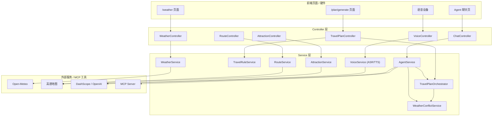

[# 天气查询与出行规划智能助手

一个集天气查询、行程规划、景点交通、智能对话与语音交互于一体的出行规划助手。支持多城市天气查询、天气冲突智能提醒、Agent 多轮对话、MCP 工具调用，并预留硬件语音交互接口。

---

## 目录

- [项目简介](#项目简介)
- [功能特性](#功能特性)
- [系统架构](#系统架构)
- [技术栈](#技术栈)
- [快速开始](#快速开始)
- [环境变量配置](#环境变量配置)
- [接口说明](#接口说明)
- [MCP 工具列表](#mcp-工具列表)
- [项目结构](#项目结构)
- [测试](#测试)
- [部署](#部署)
- [已知限制](#已知限制)
- [协作说明](#协作说明)

---

## 项目简介

本项目是一个面向出行场景的智能助手，核心能力包括：

- **天气查询**：基于 Open-Meteo 获取指定城市、日期的天气数据；
- **行程规划**：根据城市、日期、偏好生成结构化行程（景点、路线、时间轴、预算）；
- **天气冲突提醒**：检测天气与行程之间的风险（降雨、高温、大风、雷暴、开放时间冲突等），并给出调整建议；
- **智能对话**：通过 Agent 进行多轮对话，自动调用 MCP 工具完成天气查询、景点搜索、路线规划、行程生成与冲突检测；
- **语音交互接口**：提供 `/api/voice/chat` 接口，支持 ASR → Agent → TTS 的语音对话链路（接口已实现，当前版本尚未在演示中启用）。

---

## 功能特性

| 模块 | 功能 | 状态 |
|------|------|------|
| 天气模块 | 城市天气查询、天气页面展示 | ✅ 已完成 |
| 规则计划模块 | 基于天气与偏好的文字活动建议 | ✅ 已完成 |
| Agent 对话模块 | 多轮对话、工具调用、会话上下文 | ✅ 已完成 |
| 景点交通模块 | 景点搜索、景点详情、路线规划、行程生成 | ✅ 已完成 |
| 天气冲突模块 | 日级/时段级冲突检测、开放时间冲突、数据缺失提示 | ✅ 已完成 |
| 行程编排 | 生成 → 冲突检测 → 用户确认 → 修改闭环 | ✅ 已完成 |
| 语音交互接口 | ASR/TTS 接入、复用 Agent | ⚠️ 接口已实现，未启用 |
| 部署与展示 | 线上部署、环境变量、演示数据 | ✅ 已完成 |

> 语音接口代码已就绪，但由于 ASR/TTS 服务尚未在演示环境中启用，当前版本默认不开启语音链路。

---

## 系统架构


---

## 技术栈

- **语言 / 运行时**：Java 21
- **框架**：Spring Boot 3.x、Spring AI（MCP 工具支持）
- **构建**：Maven Wrapper（`mvnw`）
- **模板引擎**：Thymeleaf（旧页面 `/weather`、`/plan/generate`）
- **外部服务**：
  - 天气：Open-Meteo
  - 地图 / 景点 / 路线：高德地图（AMAP）
  - 大模型 / ASR / TTS：DashScope / OpenAI 兼容接口
- **测试**：JUnit 5、Mockito、Spring Boot Test、MockMvc

---

## 快速开始

### 1. 环境要求

- JDK 21
- Maven（使用项目自带 `mvnw` 即可，无需单独安装）
- 可访问外部服务的网络环境

### 2. 克隆与构建

```bash
git clone <repository-url>
cd wea-trav-assistant
./mvnw clean test
```

Windows 环境使用：

```bash
mvnw.cmd clean test
```

### 3. 启动

```bash
./mvnw spring-boot:run
```

启动成功后日志应包含：

```
Tomcat started on port 8080
Registered tools: N
Started WeaTravAssistantApplication
```

### 4. 访问页面

| 页面 | 地址 | 说明 |
|------|------|------|
| 天气查询 | `http://localhost:8080/weather` | 旧页面，输入城市与日期查询天气 |
| 行程生成 | `http://localhost:8080/plan/generate` | 旧页面，生成文字行程建议 |
| Agent 聊天 | `http://localhost:8080/chat` | 智能对话页面 |
| 健康检查 | `http://localhost:8080/health` | 服务健康状态 |

---

## 环境变量配置

所有敏感配置均通过环境变量注入，**不得写入仓库**。

| 变量名 | 用途 | 是否必需 |
|--------|------|----------|
| `AMAP_WEB_KEY` | 高德地图 Web 服务 Key（景点、路线） | 是 |
| `AMAP_BASE_URL` | 高德 API 基础地址 | 否（有默认值） |
| `DASHSCOPE_API_KEY` | DashScope API Key（大模型 / ASR / TTS） | 是（与下方二选一） |
| `OPENAI_API_KEY` | OpenAI 兼容接口 Key | 是（与上方二选一） |
| `OPENAI_BASE_URL` | 大模型接口基础地址 | 否（有默认值） |
| `OPENAI_MODEL` | 模型名称 | 否（有默认值） |
| `MCP_ENDPOINT` | MCP 服务端点 | 否（可空） |
| `ASR_PROVIDER` | ASR 服务提供方 | 否（默认 DashScope） |
| `TTS_PROVIDER` | TTS 服务提供方 | 否（默认 DashScope） |
| `VOICE_ENABLED` | 是否启用语音接口 | 否（默认 `false`） |

示例（Linux / macOS）：

```bash
export AMAP_WEB_KEY="your-amap-key"
export DASHSCOPE_API_KEY="your-dashscope-key"
export OPENAI_BASE_URL="https://api.deepseek.com/v1"
export OPENAI_MODEL="deepseek-chat"
```

> 语音接口相关变量仅在 `VOICE_ENABLED=true` 时生效。

---

## 接口说明

### 旧页面接口（保持兼容，勿改语义）

| 接口 | 方法 | 参数 | 返回 |
|------|------|------|------|
| `/weather` | GET | `city`, `date` | HTML 页面（`weather.html`） |
| `/plan/generate` | POST | `city`, `date`, `activityPreference` | HTML 页面（`plan.html`） |

### 新 JSON 接口

所有新接口统一返回结构：

```json
{
  "code": 200,
  "message": "success",
  "data": {},
  "timestamp": "2026-11-06T10:00:00"
}
```

| 接口 | 方法 | 说明 |
|------|------|------|
| `/api/attractions` | GET | 景点搜索（`city`, `keyword`, `limit`） |
| `/api/attractions/{poiId}` | GET | 景点详情 |
| `/api/routes/plan` | POST | 路线规划 |
| `/api/plans/generate` | POST | 生成行程（返回 `TravelPlanDTO`，含 `conflicts`） |
| `/api/plans/modify` | POST | 修改行程（改时段 / 改偏好 / 改日期 / 改城市） |
| `/api/chat` | POST | Agent 对话（`sessionId`, `message`） |
| `/api/voice/chat` | POST | 语音对话（multipart，`file` + `sessionId`），需 `VOICE_ENABLED=true` |
| `/health` | GET | 健康检查 |

### 错误码

| 错误码 | 含义 |
|--------|------|
| `INVALID_INPUT` | 参数不合法 |
| `CITY_NOT_FOUND` | 城市不存在 |
| `CITY_AMBIGUOUS` | 城市名存在歧义 |
| `OUT_OF_FORECAST_RANGE` | 超出天气预报范围（15 天） |
| `API_TIMEOUT` | 外部服务超时 |
| `WEATHER_SERVICE_UNAVAILABLE` | 天气服务不可用 |
| `WEATHER_DATA_INCOMPLETE` | 天气数据不完整 |
| `POI_NOT_FOUND` | 景点不存在 |
| `ROUTE_NOT_FOUND` | 路线不存在 |
| `API_UNAVAILABLE` | 外部服务不可用 |
| `API_QUOTA_EXCEEDED` | 外部服务配额超限 |
| `INTERNAL_ERROR` | 服务内部错误 |

---

## MCP 工具列表

| 工具名 | 说明 | 来源模块 |
|--------|------|----------|
| `search_city` | 城市搜索与歧义消解 | 天气模块 |
| `get_weather` | 获取指定城市日期天气 | 天气模块 |
| `generate_travel_plan` | 生成文字行程建议 | 规则计划模块 |
| `search_attractions` | 搜索景点 | 景点交通模块 |
| `get_attraction_detail` | 获取景点详情 | 景点交通模块 |
| `plan_transport` | 路线规划 | 景点交通模块 |
| `check_weather_conflicts` | 检测天气与行程冲突 | 天气冲突模块 |

---

## 项目结构

```
wea-trav-assistant/
├── backend/
│   └── src/
│       ├── main/
│       │   ├── java/com/example/wea_trav_assistant/
│       │   │   ├── common/            # 统一响应、适配器、偏好映射
│       │   │   ├── conflict/          # 天气冲突模块（阶段1）
│       │   │   ├── controller/        # 各模块 Controller
│       │   │   ├── dto/               # 数据模型（record）
│       │   │   ├── service/           # 业务服务
│       │   │   ├── orchestration/     # 行程编排（阶段2）
│       │   │   ├── voice/             # 语音接口（阶段3）
│       │   │   └── mcp/               # MCP 工具注册
│       │   └── resources/
│       │       ├── templates/         # Thymeleaf 页面
│       │       └── application.properties
│       └── test/
│           └── java/com/example/wea_trav_assistant/
│               ├── contract/          # 契约测试
│               ├── conflict/          # 冲突模块测试
│               ├── orchestration/     # 编排测试
│               └── voice/             # 语音接口测试
├── docs/
│   └── ...
├── README.md
└── pom.xml
```

---

## 测试

运行全部测试：

```bash
./mvnw clean test
```

测试覆盖：

| 测试类 | 覆盖内容 |
|--------|----------|
| `ContractFreezeTest` | DTO 字段契约、适配器、偏好映射 |
| `LegacyEndpointContractTest` | 旧页面接口路由与参数绑定 |
| `WeatherConflictServiceTest` | 冲突检测：null、缺字段、日级风险、时段级、开放时间、去重 |
| `WeatherAlertToolTest` | MCP 工具参数校验与委托 |
| `TravelPlanOrchestratorTest` | 生成 → 冲突 → 确认 → 修改闭环 |
| `VoiceControllerTest` | 语音接口正常与异常路径 |

---

## 部署

### 部署方式

支持任意可配置环境变量的 PaaS（如 DigitalOcean App Platform、Railway、Render 等）。

### 部署步骤

1. 在平台中创建应用，关联仓库；
2. 配置环境变量（见 [环境变量配置](#环境变量配置)）；
3. 设置启动命令：`./mvnw spring-boot:run` 或打包后 `java -jar app.jar`；
4. 部署完成后访问 `/health` 验证服务状态。

### 健康检查

```bash
curl http://<your-domain>/health
```

---

## 已知限制

1. **语音接口未启用**：`/api/voice/chat` 已实现，但当前演示环境未开启 ASR/TTS 服务，默认 `VOICE_ENABLED=false`。启用需配置 DashScope Key 并设置 `VOICE_ENABLED=true`。
2. **天气预报范围**：Open-Meteo 仅支持未来 15 天预报，超出范围返回 `OUT_OF_FORECAST_RANGE`。
3. **户外景点判断**：冲突模块基于景点 `category` 关键词判断是否户外，高德分类文本不统一时可能保守处理（不误报）。
4. **开放时间解析**：仅支持简单格式（如 `09:00-17:00`），复杂格式跳过并视为未知，不产生结论。
5. **外部服务配额**：地图、模型、ASR/TTS 均受第三方配额限制，演示时建议准备固定演示数据。
6. **数据缺失策略**：天气字段缺失时返回 `DATA_INCOMPLETE`，**不默认视为无风险**。

---

## 协作说明

本项目由多位同学协作完成，模块分工如下：

| 模块 | 负责人 | 交付内容 |
|------|--------|----------|
| 天气模块（A） | A 同学 | 天气查询、`WeatherService`、`/weather` 页面 |
| 规则计划模块（B） | B 同学 | 文字行程建议、`TravelRuleService`、`/plan/generate` 页面 |
| Agent 对话模块（C） | C 同学 | `AgentService`、`/api/chat`、会话管理 |
| 景点交通模块 | 同学 | 景点搜索、路线规划、行程生成接口 |
| 天气冲突 / 编排 / 语音 / 部署 | 集成负责人 | 冲突模块、行程编排、语音接口、部署与文档 |

**集成约定**：

- 旧页面接口（`/weather`、`/plan/generate`）语义保持不变，作为回退入口；
- 新接口统一使用 `ApiResponse` 结构；
- `TravelPlanDTO` / `ScheduleItemDTO` / `AttractionDTO` 为 Java record，不可变，冲突结果作为返回值由编排层处理；
- 阈值（35℃ / 5℃ / 30km/h / 50%）与 B 模块保持一致，变更需同步 `WeatherConflictProperties` 与文档 C-07。

---

## 许可证

本项目为课程协作项目，仅用于学习与演示。

---

> 如有问题，请优先查阅 `docs/integration/` 下的文档，或在仓库 Issue 中提出。](https://api.deepseek.com/v1)
