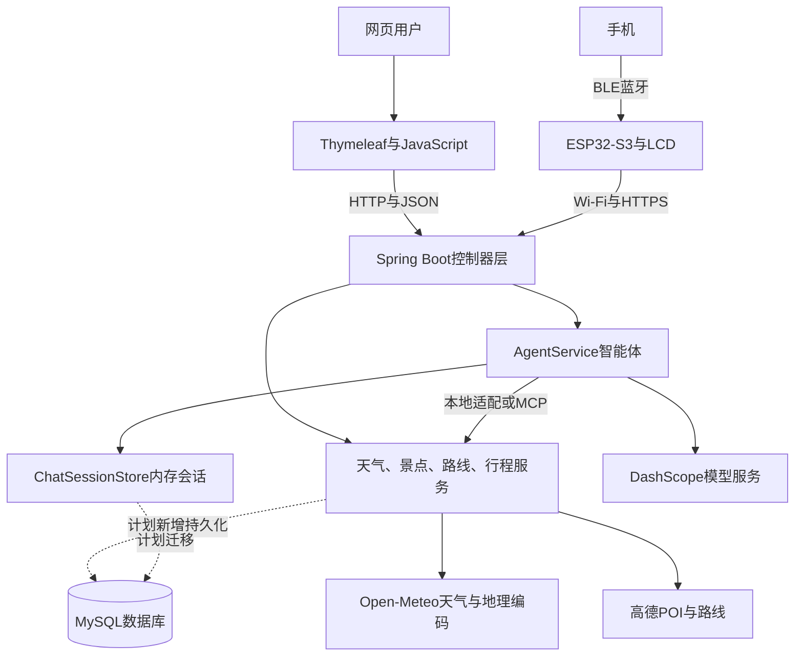
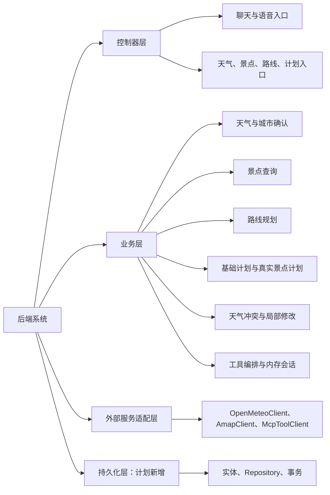
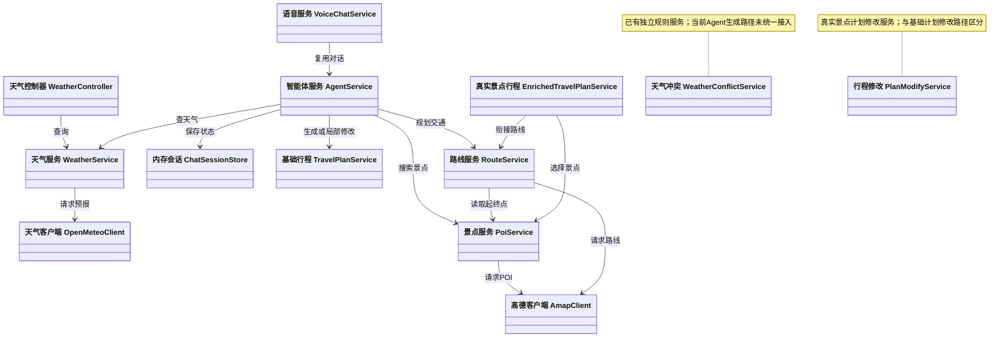
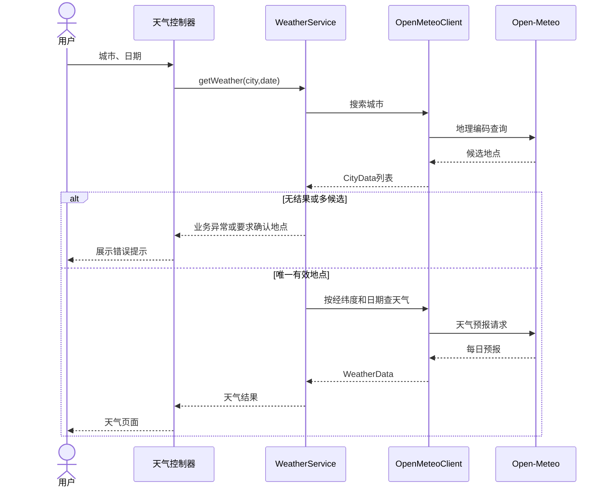
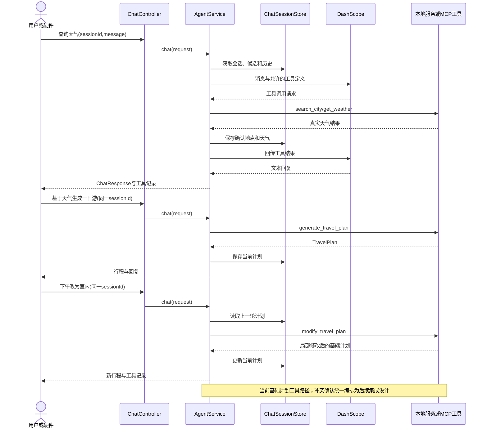
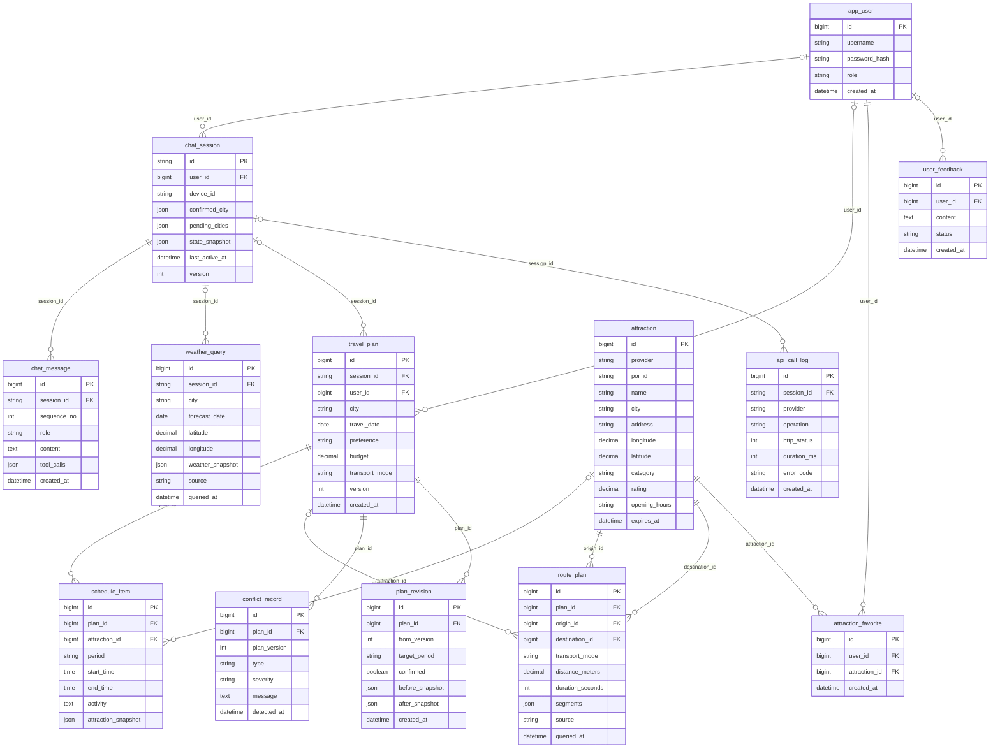

# 慢游指南成员一设计交付包

本交付包为第二次团队作业的架构、接口与数据库技术材料。图示采用Mermaid可编辑源文件，以下正文可在支持Mermaid的Markdown工具中直接预览。图片导出与最终PDF排版交成员五统一处理。未修改运行代码，未执行数据库迁移。

## 1. 缩写定义
UML：统一建模语言；API：应用程序接口；HTTP：超文本传输协议；HTTPS：加密HTTP；JSON：JavaScript对象表示法；DTO：数据传输对象；POI：兴趣点；MCP：模型上下文协议；BLE：低功耗蓝牙；LCD：液晶显示屏；ER：实体关系；ORM：对象关系映射；SQL：结构化查询语言。

## 2. 代码核对结论
本地当前分支已包含天气、Agent、景点交通、基础行程、真实景点行程、独立冲突服务与语音接口。
ChatSessionStore采用ConcurrentHashMap保存会话，历史最多24条，30分钟闲置后在访问时清理；重启不能恢复。
基础TravelPlan与真实景点TravelPlanDTO是两套数据结构。当前Agent修改调用TravelPlanService，而非完整景点计划编排器。
本地没有发现生产/api/plans/modify控制器，也没有发现TravelPlanOrchestrator。此前交付材料与当前本地代码存在差异，成员二应在集成时核对远程最终版本。
数据库实体、登录后台、Repository均为拟新增设计。图中虚线表示拟新增，实线表示当前代码依赖或通信路径。

## 系统总体架构图

## 后端功能模块图

## 后端主要类图

## 天气查询时序图

## 多轮对话时序图

## 3. 模块职责与设计选择

控制器负责输入、校验和响应；Service组织业务；Client封装上游协议；DTO描述接口字段。模型选择工具，后端检查允许的工具和已确认地点，外部服务返回真实数据。
表单天气查询与Agent候选确认不同：前者在歧义时报告问题，后者可把候选保存在会话中继续确认。
PoiService检索真实POI；RouteService基于地点和交通方式查询路线；EnrichedTravelPlanService组合早午晚景点与相邻路线。评分、营业时间等缺失值不得编造。
语音层先校验WAV格式，再通过ASR、Agent和TTS处理；当前mock与真实服务支持程度必须分别标注。

## 4. 数据库材料
见[数据库技术初稿](../database/数据库设计技术初稿.md)、[字段字典](../database/relationship-model.md)、[对象关系映射](../database/orm-mapping.md)、[建表脚本](../database/schema-design.sql)。
数据库图：

## 5. 成员间交接
- 成员二：按接口文档核对冲突编排、计划修改入口；后台原型字段以关系模型为依据。
- 成员三：前台分别适配ChatResponse和ApiResponse，天气空值不能当0；保持真实POI来源。
- 成员四：硬件使用部署地址和独立sessionId，提供网络异常提示；验收应区分mock语音和真实语音。
- 成员五：使用本交付包图文整合系统说明书，使用数据库技术稿整合数据库说明书；导出清晰图像并逐页检查PDF。本文未声明已满足某一国标，正式引用标准须核对原文。

## 6. 交付检查
已提供架构、模块、类图、两张时序图、接口契约、ER图、关系模型、ORM映射与DDL。
图源与文档可编辑；SQL为设计审阅稿，尚未在MySQL执行；Mermaid尚未渲染为PNG，最终需在渲染工具确认文字布局。

